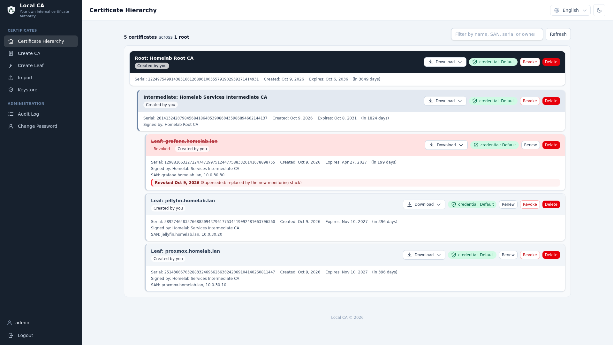
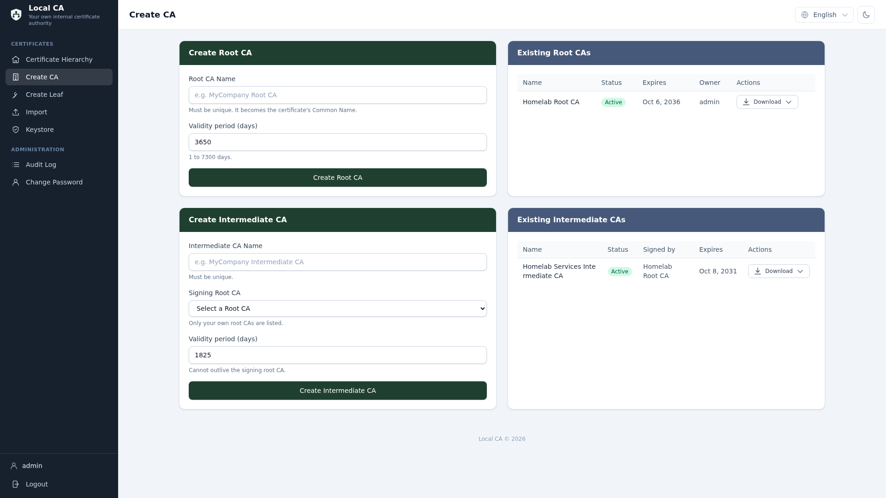
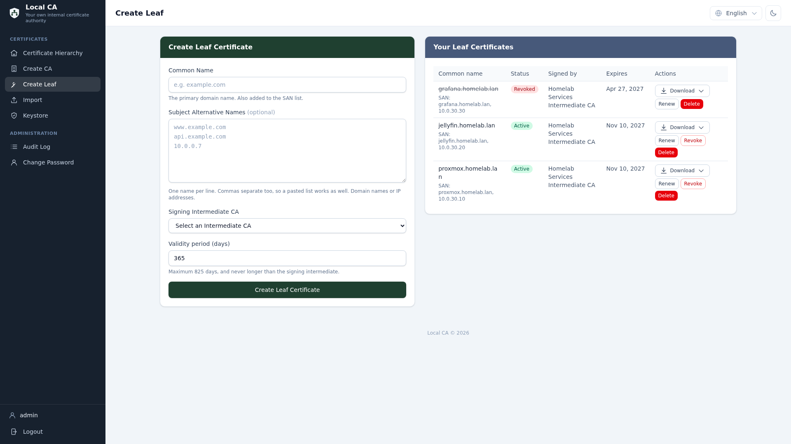
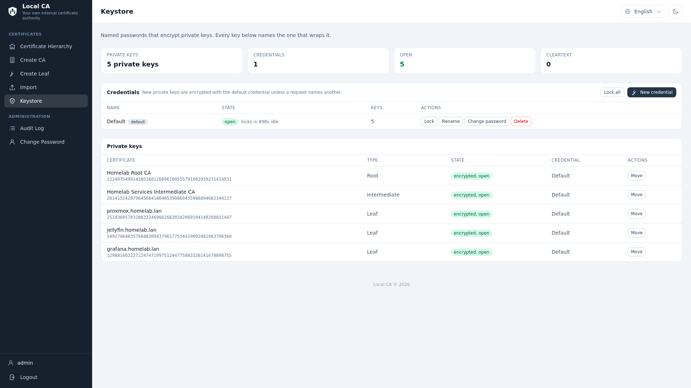
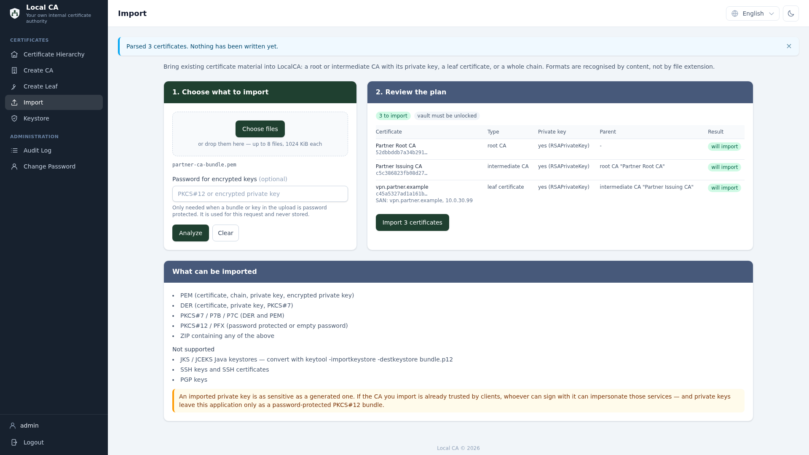
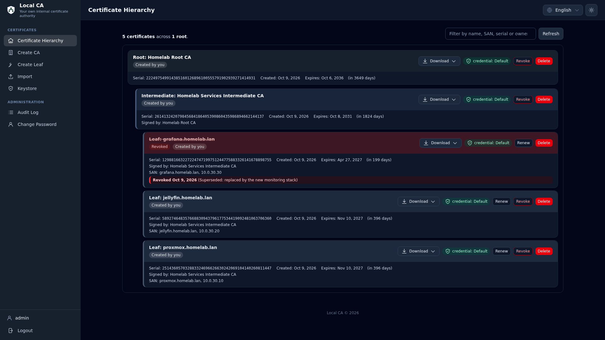
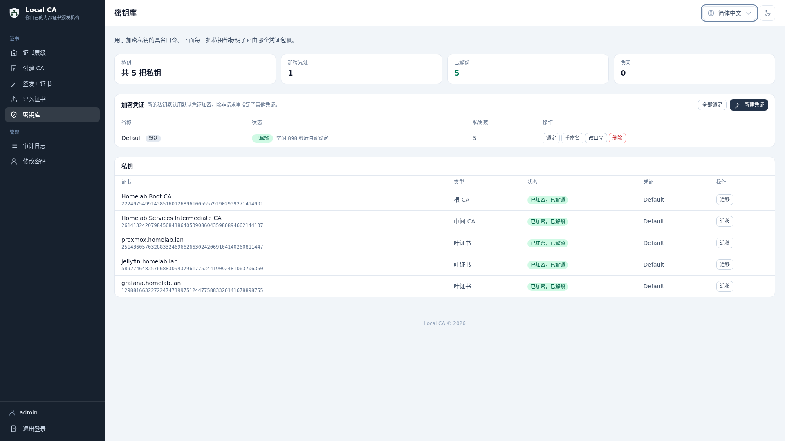

# Local CA
Local CA - Your Own Internal Certificate Authority!

[](https://github.com/Dynesshely/LocalCA/actions/workflows/pylint.yml)
[](https://github.com/Dynesshely/LocalCA/actions/workflows/django.yml)

## Welcome to Local CA!

Local CA is an open source self-hosted certificate authority that allows you to run your own [PKI infrastructure](https://en.wikipedia.org/wiki/Public_key_infrastructure) internally or in your homelab/home network.

Say goodbye to those pesky HTTPS INSECURE  warnings when browsing your locally hosted web services!
Local CA serves a Vue 3 single-page web UI from Django: create and download root certificates, intermediate certificates and leaf/end user certificates to secure your services.

With the certificates generated by Local CA, you can add HTTPs to your local instances of Proxmox, Adguard Home, Pi-Hole, Jellyfin, Grafana, Homepage, [Bitwarden](https://bitwarden.com/help/certificates/#use-an-existing-ssl-certificate) etc.



### Features
- Secure your home network with HTTPS without the need for Let's Encrypt (and their complicated setup requirements).
- Create root, intermediate and leaf certificates. The root certificate is self signed, and you need to install it in your browser or client devices as a one time setup.
- Host the Local CA app locally and use the web UI to download certificates.
- Simple and lightweight deployment using docker.
- Personal branding - Name your root certificates whatever you want!
- Use in Mutual TLS (mTLS) applications.
- Bilingual interface - the whole UI, and the server's own messages, in English or
  Simplified Chinese; the switch is in the top bar and the choice is remembered.
- A full-height sidebar layout with light and dark themes.
- Download any certificate as PEM, DER, a full chain (PEM or PKCS#7), a PKCS#12
  bundle, an encrypted or unencrypted private key, or a ready-to-deploy ZIP pair.
- A **keystore** page: several named credentials, each its own password, every
  private key labelled with the one that wraps it -- plus its state, and the
  actions to encrypt, move, open and lock them.
- **Renew a leaf certificate** with an edited SAN list: same common name and
  issuer, fresh key pair, and the certificate being replaced is revoked as
  superseded while keeping a pointer to its replacement.

### Screenshots


Create a root CA, and intermediate CAs signed by it


Issue leaf certificates for your services — with SANs — and revoke or delete them from the same page


The keystore: which credential wraps which private key, and whether it is open


Import certificates you already have: a CA with its private key, a leaf, or a whole chain — PEM, DER, PKCS#7, PKCS#12 or a ZIP of those


Light and dark themes, following the operating system by default


English or Simplified Chinese — including the messages the server sends back

## Quick Start

LocalCA is two containers: the application (Django + the built SPA, listening on
8000) and nginx, which serves the static files and proxies everything else. You
need [docker](https://docs.docker.com/engine/install/) with the compose plugin.
**Do not expose this on the internet** — it issues certificates for a private
network.

```bash
git clone https://github.com/Dynesshely/LocalCA.git
cd LocalCA

# The database directory is a bind mount, so create it and hand it to the uid the
# container runs as (see "3. The container no longer runs as root" if you hit
# "unable to open database file" instead).
mkdir -p db && sudo chown -R 10001:10001 db

# The one required setting: a secret key of your own.
export DJANGO_SECRET_KEY=$(python3 -c "import secrets; print(secrets.token_urlsafe(50))")

docker compose up --build -d
```

Then open `http://<host>/`. There is **no default password**: on first start the
container creates a superuser named `admin` and prints a randomly generated
password once in the log (`docker compose logs web`). Set
`DJANGO_SUPERUSER_PASSWORD` before that first start to choose your own, and change
it in the UI after signing in.

`docker compose down` stops it; the database and static files live in named
volumes, so `down` keeps your data and `down -v` does not.

To run a *published* image instead of building, use `docker-compose-harbor.yml`
with `LOCALCA_IMAGE` and `LOCALCA_TAG` (see [Configuration](#configuration)), and
[scripts/image-push.sh](scripts/image-push.sh) to publish one to a registry of
your own — it reads the registry coordinates from the environment, never from the
repository.

### Deploy Behind Reverse Proxy (Traefik, Nginx, etc.)

LocalCA supports deployment behind reverse proxies with custom path prefixes. For example, to deploy at `https://yourdomain.com/localca`:

1. Set the `URL_PREFIX` environment variable: `URL_PREFIX=/localca`
2. Configure your reverse proxy to strip the path prefix before forwarding to LocalCA
3. Add your domain to `CSRF_TRUSTED_ORIGINS`

For detailed instructions on deploying behind Traefik, see [TRAEFIK_DEPLOYMENT.md](TRAEFIK_DEPLOYMENT.md) or use the included `docker-compose-traefik.yml` example configuration.

### Configuration

#### Timezone Configuration

By default, LocalCA uses UTC timezone for all timestamps and certificate expiry dates. You can customize this by setting the `TZ` environment variable in your docker-compose file:

```yaml
environment:
  - TZ=America/New_York  # Set to your desired timezone
```

Common timezone examples:
- `UTC` (default)
- `America/New_York`
- `America/Los_Angeles`
- `Europe/London`
- `Asia/Tokyo`

For a complete list of valid timezone names, see the [IANA Time Zone Database](https://en.wikipedia.org/wiki/List_of_tz_database_time_zones).

### Building and publishing images

`docker compose up --build` builds both images locally. To publish them to a
registry of your own, [scripts/image-push.sh](scripts/image-push.sh) tags and
pushes the application image, retrying the large layers (a registry proxy in front
can time out on them):

```bash
export HARBOR_HOST=registry.example.net
export HARBOR_PROJECT=myproject
./scripts/image-push.sh 2.1.0        # or: ./scripts/image-push.sh
```

The tag defaults to the version in `frontend/package.json`. The 8000-port image
does not serve static files, so a deployment also needs nginx — either
`nginx:alpine` with [nginx.conf](nginx.conf), or the small
[Dockerfile.nginx](Dockerfile.nginx) image built from it. Never commit the
registry coordinates: put them in `scripts/harbor.env`, which is gitignored.

The application image runs unprivileged (`APP_UID`/`APP_GID`, default 10001). If
your bind-mounted `db` is owned by another account, either `chown` it or build
with `--build-arg APP_UID=$(id -u) --build-arg APP_GID=$(id -g)`.

### Security

Logins and passwords are Django's own (hashed, session-cookie authenticated),
and every certificate action is written to the audit log.

**Private keys are encrypted at rest.** Each one is wrapped with a keystore
credential — a named password, checked against a scrypt-derived key — so a copy of
`db.sqlite3` or of a volume snapshot does not yield a usable key, and there is no
unauthenticated path to one. What that does *not* protect against is somebody who
controls the running server: an operator who can unlock a credential can use its
keys, by design.

So keep it where a private CA belongs: on your own network, with the host
hardened, `db.sqlite3` readable only by the service account, and the UI reached
over HTTPS (put a TLS-terminating proxy in front, or use `DJANGO_SECURE_COOKIES`). 

#### Required configuration

Django refuses to start without a secret key. Copy `.env.example` to `.env`
next to the compose file you use and set at least:

```bash
cp .env.example .env
python3 -c "import secrets; print(secrets.token_urlsafe(50))"   # paste into DJANGO_SECRET_KEY
```

- `DJANGO_SECRET_KEY` — required, must stay secret and must not be committed.
- `DJANGO_ALLOWED_HOSTS` — the hostnames/IPs you reach LocalCA under.
- `DJANGO_DEBUG` — leave `false`. With debugging on, any unhandled error renders
  a page that includes the secret key, settings and local variables.
- `DJANGO_SECURE_COOKIES=true` — enable once served over HTTPS; this turns on
  secure cookies, HSTS and an HTTP-to-HTTPS redirect.

#### Private keys are encrypted at rest

Certificate private keys are not stored in cleartext. Each is wrapped with a
**keystore credential**: a name, a password, and the root key that password
unwraps. An account may hold several — one for production, one for a lab — and
every private key records the credential that wraps it, so a password that leaks
or is forgotten costs you that credential rather than the whole account.

The [Keystore](#screenshots) page is where this is managed, and it is the honest
inventory: each key with its state (encrypted and open, encrypted and locked,
cleartext, ownerless, no key at all) and the credential's name next to it.

* On your first action that needs a key — signing, not merely exporting a
  certificate that predates the keystore — LocalCA asks you to **create a
  credential**. It is not the same as your login password, though nothing stops
  you using the same value. Keys of yours that are still cleartext are
  **encrypted at that moment**, so an account never sits half-protected because
  somebody forgot to run a command.
* Each credential is opened on its own, with its own password, and stays open in
  the server's memory for 15 minutes of inactivity
  (`LOCALCA_VAULT_IDLE_TIMEOUT` to change it) before locking again. Opening one
  does not open another, and either can be locked from the page — one at a time,
  or all at once.
* **There is no recovery.** If a credential's password is lost, every private key
  under *that credential* becomes permanently unreadable, including CA keys. No
  administrator can reset it — which is also why a key that must stay reachable
  after a lost password should live under a credential of its own. A credential
  with keys still pointing at it cannot be deleted; move them somewhere else
  first.
* New keys go to the credential marked **default**, unless a request names another
  one. A certificate's key can be moved between credentials from the keystore
  page: it is decrypted with the one that holds it and re-encrypted with the
  target, so nothing is copied.
* Keys belonging to a certificate with no owner remain cleartext: there is no
  account whose credential could wrap them, so `python manage.py vault_status`
  lists them as `orphaned`. Assign an owner and run
  `python manage.py rewrap_keys --username <user>` to encrypt the rest.
* Private keys leave the server only through the Download menu's guarded formats:
  two password-protected ones, one where you choose the passphrase, and one that
  must be explicitly confirmed. See
  [Downloading certificates and keys](#downloading-certificates-and-keys).

#### Certificate revocation

Certificates can be revoked from the UI (leaf, intermediate and root). The
revocation is recorded here with an RFC 5280 reason code and an audit entry, so
"revoked" in this app means "recorded and no longer offered for download" — it
is **not** published to clients. LocalCA does not yet serve a CRL or an OCSP
responder, so a certificate that was already installed keeps working until it
expires or you remove it from the trusting system. The confirmation dialog says
this explicitly before you revoke.

#### Deleting certificates

Deleting removes the private key material from the database and cannot be
undone. Deleting a root or intermediate also deletes everything it signed; the
UI warns with the exact count first. Owners may manage their own certificates,
and staff users may manage any certificate.

## Upgrading from an earlier version

If you already run an earlier LocalCA — the upstream layout, where the whole
project sat directly in `/app` — then **replacing the image is not a drop-in
swap**. Your certificates, accounts and audit log are compatible and survive the
upgrade; what changed is the container's contract, in three ways, and each one
misbehaves if you skip it.

### 1. Two environment variables are now required

`DJANGO_SECRET_KEY` is mandatory: LocalCA refuses to start without it. With
`DJANGO_DEBUG=false` (the default) `DJANGO_ALLOWED_HOSTS` is mandatory too. Put
`.env` next to your compose file, generate a key, and list every hostname you
browse LocalCA under:

```bash
cp .env.example .env
python3 -c "import secrets; print(secrets.token_urlsafe(50))"   # into DJANGO_SECRET_KEY
```

### 2. The paths inside the container moved

The image now mirrors the repository layout: the Django project lives in
`/app/localca_project`, and the database and the collected static files moved
with it.

| What | Earlier images | Current image |
| --- | --- | --- |
| SQLite database | `/app/db` | `/app/localca_project/db` |
| Collected static files | `/app/staticfiles` | `/app/localca_project/staticfiles` |

**Update the `web` service's volume targets.** The volume keeps its contents;
only the path it is mounted at changes, so nothing is copied or converted:

```yaml
  web:
    volumes:
      - db:/app/localca_project/db                      # was db:/app/db
      - static_volume:/app/localca_project/staticfiles  # was static_volume:/app/staticfiles
```

nginx keeps `/app/staticfiles`: it mounts the same named volume, and `nginx.conf`
aliases that path. If you skip this step the container still starts — but it
creates a **new, empty database** in its own filesystem layer and serves no
CSS/JS. Your data is not gone, it is simply not mounted.

### 3. The container no longer runs as root

It runs as uid/gid 10001 by default, so the database and the collected static
files have to be **writable by that uid**. A database written by an earlier
root-running image is owned by root, and a bind-mounted one is owned by your own
host account; in either case the new container cannot write it.

SQLite's wording for this is worth knowing, because the two cases produce
different errors and neither one names the real problem:

| What is not writable | What you see |
| --- | --- |
| the `db` **directory** (no database file yet) | `unable to open database file` |
| an existing `db.sqlite3` **file** | `attempt to write a readonly database` |

`start.sh` checks both — and the static directory — before it starts Django, and
reports the path, its owner and the uid it runs as instead of a traceback. Fix it
on the host, once:

```bash
# a) build the image to run as the volume's owner (best for bind mounts)
docker build --build-arg APP_UID=$(id -u) --build-arg APP_GID=$(id -g) -t localca .

# b) or give the existing volume to the container's user, once
docker volume inspect <project>_db            # find the mountpoint
docker run --rm -v <project>_db:/db alpine chown -R 10001:10001 /db
```

#### A *fresh* deployment on a bind mount needs the directory to exist first

If your compose file bind-mounts `./db` and that directory is not there yet,
docker creates it for you — as `root`, mode 0755. The container can read it but
not write in it, and the very first `migrate` fails with `unable to open database
file`. Create and hand over the directory before the first start:

```bash
mkdir -p db && sudo chown -R 10001:10001 db
docker compose up -d
```

`docker-compose-harbor.yml` sidesteps this entirely by using named volumes, which
docker initialises from the image and therefore already owns.

### What happens to your data

Migrations `0002` (revocation targets and comment), `0003` (private key
encryption) and `0004` (keystore credentials) apply in place on the existing
database, and `0005` only adds a nullable column for renewal links. The upgrade
was verified end to end against a database from the previous version: accounts and
their password hashes, roots/intermediates/leaves with their SANs, revocations —
including pre-RFC 5280 free-text reasons — and the audit log all survive, and you
sign in with your existing password.

An account that had a single vault password keeps it: migration `0004` turns that
root key into a credential named **Default** and stamps every already-wrapped key
with it, without re-encrypting anything.

Private keys created by an even earlier version stay in the legacy plaintext
column until a credential wraps them:

```bash
python manage.py vault_status                       # which keys are encrypted, and by what
python manage.py rewrap_keys --username <user>      # wrap the rest (idempotent)
python manage.py rewrap_keys --username <user> --credential Production
```

There is no key import in this version — it only issues certificates, it never
ingests them. So exporting every PKCS12 from the old site and importing it into a
fresh one is not an available route; upgrading the database in place is the
supported path.

Before you start, copy `db.sqlite3` (or the named volume) somewhere safe. Rolling
back means restoring that copy: the migrations add columns and tables, and the
older code is not tested against the newer schema.

## Downloading certificates and keys

Every certificate in the hierarchy (and in the two creation pages) has a
**Download** menu offering the same set of formats, grouped by what they give
away. The list is served by `/api/meta/`, so the menu and the endpoints cannot
disagree.

| Format | What you get |
| --- | --- |
| Certificate (PEM) | The certificate on its own |
| Certificate (DER) | The same, binary, for Windows and Java tooling |
| Full chain (PEM) | The certificate, its intermediates and the root, in that order |
| Full chain (PKCS#7) | The whole chain in one `.p7b` |
| PKCS#12 bundle | Certificate and key in one password-protected `.p12` |
| Private key, encrypted | PKCS#8 `.key`, protected by a password you choose |
| Private key, unencrypted | PKCS#8 `.key`, no password — what nginx and apache need |
| Certificate + key bundle | A `.zip` holding `.crt`, `.key` and `chain.pem` |

The first four are **public**: they are the certificate material a client needs
in order to trust this CA, so they need no session. The last four contain the
private key and require all of:

* an authenticated session, and that the certificate is **yours** — staff can
  revoke, delete and export the certificate of another account, but never its
  private key: the key is wrapped with *that* account's credential and there is no
  escrow, so the menu offers those formats as unavailable rather than letting the
  request fail;
* the **credential that wraps the key open**, so it can be decrypted at all — a
  locked one answers `409` with `vault_locked`, `credential_id` and
  `credential_name`, and the interface asks for that credential's password and
  then retries the exact request;
* for the protected formats, an export password of at least eight characters;
* for the unprotected ones, an explicit `confirm=true`. The interface puts that
  behind a checkbox, so a stray click cannot put a CA key on disk in the clear.

Every download is written to the audit log as `DOWNLOAD_PUBLIC_KEY`,
`DOWNLOAD_PRIVATE_KEY` or `DOWNLOAD_PKCS12`.

> Unprotected private keys exist because the alternative is worse: an operator
> who needs a bare `.key` for nginx will run `openssl pkcs12 -nodes` on their own
> machine, which leaves no audit trail and no ownership check at all. What the
> guards above buy is that it is never accidental, never someone else's key, and
> always recorded.

## Renewing a certificate

A certificate is what it was signed as, so LocalCA never edits one. **Renew** on a
leaf issues a *new* certificate and retires the old one:

* the **common name and the signing intermediate are inherited** — changing either
  is issuing a different certificate, which is what Create Leaf is for;
* the **SAN list is editable**, prefilled with the names the certificate already
  answers to, one per line or comma-separated;
* the **key pair is always regenerated**, because re-issuing around a key that may
  have leaked is the point of a renewal;
* the replacement's key is stored under **the same keystore credential** as the
  old one (an explicit `credential_id` overrides that), so a certificate filed
  under "Production" does not quietly move;
* the certificate being replaced is **revoked with reason `superseded`** and keeps
  a pointer to its replacement, so "which certificate is live for this name?" has
  one answer. It stays in the tree, marked *renewed*, and offers no second
  renewal — renew its replacement instead.

Renewal is available from the leaf table and from the leaf's card in the
hierarchy. `POST /api/certificates/leaf/<id>/renew/` takes `san` and
`validity_days`, and answers `409` when the signing CA's credential is locked
(with `credential_id`, so the interface can ask for the right password and retry).

## Importing certificates

LocalCA can ingest certificate material you already have: a CA with its private
key, a leaf certificate, or a whole chain. The page is **Import** in the top
navigation (`/import`).

Formats are recognised by **content, not by file extension**:

| Accepted | Notes |
| --- | --- |
| PEM | one or many objects per file; certificate and key may be in the same file or in separate files of one submission; `TRUSTED CERTIFICATE` labels are handled |
| Private keys | PKCS#8, PKCS#1, SEC1, and **encrypted** PKCS#8 or traditional OpenSSL (`Proc-Type: 4,ENCRYPTED`) — supply the password |
| DER | certificate, private key, PKCS#7 |
| PKCS#7 / P7B / P7C | DER and PEM. Certificates only, by construction |
| PKCS#12 / PFX | key plus certificate plus additional chain certificates; a single key entry |
| ZIP | a container for any of the above, which is what a bulk migration looks like |

Not supported: **JKS/JCEKS** Java keystores (convert first with
`keytool -importkeystore -destkeystore bundle.p12`), SSH keys and SSH
certificates, and PGP keys — none of those are X.509 material this application
could sign with or export.

### It is a two-step operation

1. **Analyze** uploads the files and returns a plan: every certificate found, the
   type it was recognised as, whether a matching private key came with it, where
   it would sit in the hierarchy, and whether it would be created, skipped or
   refused. **Nothing is written.**
2. **Import** re-uploads the same files to apply that plan.

Nothing is staged on the server between the two steps, so no uploaded key
material outlives a request.

### Two rules the importer follows

* **Private keys go through the keystore.** An imported key is wrapped exactly
  like a generated one, so an import that carries a key needs a credential open
  (you are prompted, the same way signing prompts you). There is no path that
  writes an uploaded key to the legacy cleartext column.
* **A certificate without a key is inventory.** It is listed, can be revoked and
  downloaded as PEM, but it cannot sign and cannot be exported as PKCS#12. The
  UI marks it `no private key`, and such a CA is left out of the signing menus
  rather than offered and then refused.

### What ends up where

* A **self-signed CA** becomes a root.
* An **intermediate** must be issued by a root that is in the upload or already
  stored; a **leaf** must be issued by an intermediate. A leaf issued directly by
  a root, or a self-signed end-entity certificate, cannot be represented in the
  root/intermediate/leaf model and is reported as such in the plan instead of
  being forced in.
* The same certificate twice (same SHA-256 fingerprint) is skipped when it is
  already stored. A certificate stored **without** a key, whose key is in the
  upload, gets the key **added**.
* A certificate whose serial number is already used by a *different* certificate
  is refused: serial numbers are unique across the application, so that one needs
  a human decision.
* Imported certificates belong to the account that imported them. A certificate
  may only be attached under a CA that account owns; staff may extend any CA.
* Every import is recorded in the audit log.

### Limits

Up to 8 files, 1 MiB per file, 5 MiB in total and 200 certificates/keys per
submission. ZIP archives are additionally capped by entry count, expanded size
and compression ratio.

### Treat an imported CA with the same care as a generated one

An imported private key is as sensitive as one LocalCA generated. If the CA you
import is already trusted by your clients, then anyone who can sign with it can
impersonate those services — and private keys leave this application under the
guards described in [Downloading certificates and keys](#downloading-certificates-and-keys).

## Architecture

LocalCA is split into a JSON API and a single-page frontend:

```
localca_project/          Django: JSON API, ORM, auth, certificate operations
  LocalCA/
    api_urls.py           The API's URL map
    api.py                Endpoints: session/CSRF auth, JSON in and out
    serializers.py        Certificate -> JSON, including per-user rights
    ca.py                 Certificate generation (cryptography; never shells out to openssl)
    forms.py              Server-side validation for every certificate input
    models.py             Roots, intermediates, leaves, revocations, credentials, audit log
    keys.py               Which key lives under which credential, and how to use it
    vault.py              The envelope format: scrypt KEK, root key, HKDF per key
    importers.py          Parsing uploaded bundles (content, not filenames)
    import_service.py     Planning and applying an import
    throttle.py           Login attempt limits
frontend/                 Vue 3 SPA (Vite + Tailwind CSS 4)
  src/
    api/                  Endpoint wrappers, CSRF, error shape, downloads
    stores/               Pinia: session, certificates, keystore, toasts
    views/                One component per page
    components/           Shell, certificate tree, dialogs, form controls
    composables/          Shared behaviour (the download flow)
    i18n/                 Catalogs and locale handling, one file per namespace
```

Django renders no application pages. It authenticates (session cookie plus CSRF
token), serves the API under `/api/`, and serves the built SPA for every other
path so client-side deep links such as `/create/leaf` work.

### Development steps

Backend:

```bash
git clone https://github.com/Dynesshely/LocalCA.git
cd LocalCA
python3 -m venv venv
source venv/bin/activate
pip install -r requirements.txt

cd localca_project
export CSRF_TRUSTED_ORIGINS="http://localhost:5173"
export DJANGO_SECRET_KEY=$(python3 -c "import secrets; print(secrets.token_urlsafe(50))")
export DJANGO_DEBUG=true
export DJANGO_ALLOWED_HOSTS=127.0.0.1,localhost

# Migrations are committed, so apply them rather than regenerating.
python manage.py migrate
python manage.py runserver 8000
```

Frontend, in a second terminal. Vite proxies `/api` to Django, so the SPA and
the API share an origin and session/CSRF behave exactly as in production:

```bash
cd frontend
pnpm install
pnpm dev            # http://localhost:5173, proxies /api to :8000
```

To build the bundle that Django serves, run `pnpm build` from `frontend/`: it
writes `frontend/dist`, which `settings.py` picks up automatically. Without a
build, `/` returns a short placeholder page explaining how to make one.

### Translations

The interface is translated in `frontend/src/i18n/messages/<locale>/`, one JSON
file per namespace; the file's top-level key *is* the namespace, so
`en/leaf.json` provides `leaf.*` and adding a feature means adding a file. The
loader merges them, so no index needs editing.

Server-authored text — validation errors, rate limits, revocation reason labels —
is translated with Django's gettext from `localca_project/locale/`. The SPA sends
its current locale in `Accept-Language`, so an error always comes back in the
language the page is drawn in:

```bash
python3 scripts/i18n.py check     # every msgid in the code has a translation
python3 scripts/i18n.py compile   # .po -> .mo (no GNU gettext needed)
python3 scripts/i18n.py extract   # what is translatable, and where
```

Both the `.po` and the generated `.mo` are committed, because neither the
`python:3.12-slim` image nor a bare dev machine ships `msgfmt`. Where GNU gettext
*is* available, `manage.py makemessages` / `compilemessages` remain a drop-in
replacement for the first two commands.

`LocalCA/tests_i18n.py` asserts the catalogues are complete and that the same
request answers in the requested language, so a translation cannot silently fall
behind the code it belongs to.

Every asset name carries a content hash, so a rebuilt bundle can never be served
from a stale browser cache. Django does cache the parsed shell template, though:
if `runserver` was started with `--noreload` (as the development setup here does)
restart it after a rebuild, otherwise it keeps serving the previous asset names.

Run the test suite (it does not need a real key):

```bash
DJANGO_TESTING=true python manage.py test LocalCA
```

Build and deploy locally with the above instructions. LocalCA is under active development and contributions are welcome!
