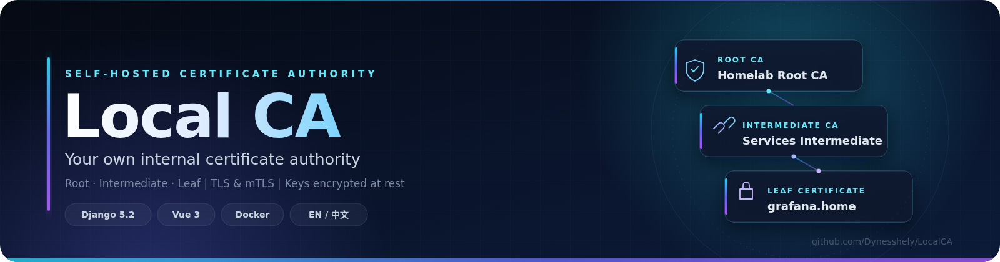

<div align="center">
  
</div>

<h1 align="center">Local CA</h1>

<p align="center">
  <b>Your own internal certificate authority.</b><br>
  Self-hosted PKI for the homelab — root, intermediate and leaf certificates, a modern web UI,
  encrypted private keys, and a one-command Docker deployment.
</p>

<p align="center">
  <a href="https://github.com/Dynesshely/LocalCA/actions/workflows/django.yml"></a>
  <a href="https://github.com/Dynesshely/LocalCA/actions/workflows/pylint.yml"></a>
  <a href="LICENSE"></a>
  <a href="frontend/package.json"></a>
  <a href="requirements.txt"></a>
  <a href="docker-compose.yml"></a>
</p>

## Why Local CA

Your router, NAS, Proxmox, Grafana and Jellyfin all speak HTTPS — and all show a warning until
they get a certificate the browser already trusts. Public CAs cannot sign `.home` or
`192.168.x.x`, and Let's Encrypt is the wrong tool for a private network.

Local CA is the missing piece: a small, self-hosted PKI console that issues a root CA you install
once, intermediate CAs you can scope per site, and leaf certificates for every service. Everything
runs on your network; nothing leaves it.

## Highlights

| | |
| --- | --- |
| **Full PKI hierarchy** | Self-signed root → intermediate → leaf, with SANs, per-certificate validity, revocation and deletion; ready for mTLS. |
| **Encrypted keystore** | Every private key is wrapped by a named keystore credential (scrypt-derived KEK + HKDF per key). Credentials unlock individually and re-lock after idle. No escrow, no recovery. |
| **Nine download formats** | PEM/DER certificate, full chain (PEM or PKCS#7), PKCS#12, encrypted or plain PKCS#8 key, and ZIP bundles. Private-key exports are owner-only, password-guarded and audited. |
| **Import existing material** | Content-sniffed PEM, DER, PKCS#7, PKCS#12 and ZIP. Analyze first, then apply; imported keys go through the same keystore. |
| **Renewal with lineage** | Re-issue a leaf with an edited SAN list and a fresh key pair; the old certificate is revoked as `superseded` and points at its replacement. |
| **Audited by default** | Logins, issuance, downloads, imports and revocations are recorded. Django session auth + CSRF protect the API. |
| **Bilingual and themed** | English and 简体中文 across the UI and server messages; light and dark themes follow the OS. |
| **Small deployment** | Django + SQLite behind nginx, two containers, an unprivileged app user, no external services. |

## Screenshots

<p align="center">
  <a href="screenshots/hierarchy-light.png"></a>
  <a href="screenshots/hierarchy-dark.png"></a>
</p>
<p align="center"><sub>The certificate hierarchy — light and dark themes.</sub></p>

<p align="center">
  <a href="screenshots/keystore.png"></a>
  <a href="screenshots/import.png"></a>
</p>
<p align="center"><sub>Keystore credentials, and importing an existing chain.</sub></p>

<p align="center">
  <a href="screenshots/create-ca.png"></a>
  <a href="screenshots/create-leaf.png"></a>
</p>
<p align="center"><sub>Create a hierarchy, then issue leaf certificates with SANs.</sub></p>

## Tech stack

| Layer | What we use |
| --- | --- |
| **Backend** | Python 3.12 · Django 5.2 LTS · `cryptography` — X.509 is generated in-process, never by shelling out to `openssl` |
| **Frontend** | Vue 3.5 · Vite 7 · Tailwind CSS 4 · Pinia · vue-i18n |
| **Storage** | SQLite in the app directory; private keys encrypted at rest (scrypt + HKDF envelope) |
| **Delivery** | Docker image running as uid 10001, plus nginx for static files; optional registry push via `scripts/image-push.sh` |
| **API** | A Django JSON API under `/api/`, with one module per capability; no DRF and no server-rendered application pages |
| **i18n** | Per-namespace JSON catalogues in the SPA, Django gettext on the server; both compiled into the image |

## Architecture

```text
Django (JSON API + auth + X.509) ─────── SQLite
      │  session cookie + CSRF
      ▼
Vue 3 SPA (content-hashed bundle served by Django)
```

Django serves the built SPA for every non-API path, so client-side deep links work. API endpoints
are split by capability (`api/issuance.py`, `api/downloads.py`, `api/keystore.py`, …), and the
frontend keeps session, certificate and keystore state in Pinia stores. See
[docs/DEVELOPMENT.md](docs/DEVELOPMENT.md) for the full layout and
[DECISIONS.md](DECISIONS.md) for the design trade-offs.

## Quick start

**Requirements:** Docker with the Compose plugin. Keep LocalCA on a trusted network — it issues
certificates for a private PKI and must not be exposed to the internet.

```bash
git clone https://github.com/Dynesshely/LocalCA.git
cd LocalCA

# The database directory is bind-mounted: create it for the container uid.
mkdir -p db && sudo chown -R 10001:10001 db

# The one required setting: a secret key of your own.
export DJANGO_SECRET_KEY=$(python3 -c "import secrets; print(secrets.token_urlsafe(50))")

docker compose up --build -d
docker compose logs -f web   # admin password, printed once on first start
```

Open `http://<host>/` and sign in as `admin` with the generated password. There is **no default
password**; set `DJANGO_SUPERUSER_PASSWORD` before the first start to choose your own.

`docker compose down` stops the stack and keeps the volumes; `down -v` removes them. To run a
published image instead of building, use `docker-compose-harbor.yml` with `LOCALCA_IMAGE` and
`LOCALCA_TAG`; [scripts/image-push.sh](scripts/image-push.sh) tags and pushes the application
image to a registry of your own (see [docs/DEPLOYMENT.md](docs/DEPLOYMENT.md)).

## Configuration

Copy [`.env.example`](.env.example) to `.env` beside the compose file you use. Django refuses to
start without a secret key, and with `DJANGO_DEBUG=false` it also requires `DJANGO_ALLOWED_HOSTS`.

| Variable | Required | Purpose |
| --- | --- | --- |
| `DJANGO_SECRET_KEY` | **yes** | Signing key for sessions and CSRF; never commit it. |
| `DJANGO_ALLOWED_HOSTS` | **yes** (non-debug) | The hostnames / IPs you browse LocalCA under. |
| `DJANGO_DEBUG` | no | Keep `false`; debug pages can leak settings and locals. |
| `DJANGO_SECURE_COOKIES` | recommended | Behind HTTPS: secure cookies, HSTS, HTTP → HTTPS redirect. |
| `DJANGO_SUPERUSER_PASSWORD` | first start | Sets the `admin` password instead of printing a generated one. |
| `TZ` | no | Timezone for timestamps and certificate expiry (default `UTC`). |
| `URL_PREFIX` | no | Mount under a sub-path (for example `/localca`) behind a reverse proxy. |

For a TLS-terminating reverse proxy, image publishing, time-zone examples and the required settings in detail, see [docs/DEPLOYMENT.md](docs/DEPLOYMENT.md).
Upgrading from the old single-container layout? Read [docs/UPGRADING.md](docs/UPGRADING.md) first.

## Security model

- **Private keys are encrypted at rest.** Each key is wrapped by a keystore credential — a named
  password checked against a scrypt-derived key — so a copy of `db.sqlite3` or a volume snapshot
  yields no usable key. Credentials unlock individually and lock after 15 minutes of inactivity.
- **No recovery, by design.** A lost credential password makes every key under that credential
  permanently unreadable, including CA keys. There is no escrow and no administrator reset.
- **Revocation is recorded, not published.** LocalCA writes an RFC 5280 reason and an audit entry,
  but serves no CRL or OCSP responder; a certificate already installed keeps working until it
  expires or is removed from the trusting system.
- **Deletion is irreversible.** Removing a root or intermediate also removes everything it signed;
  the UI states the count first.
- **A private CA belongs on a private network.** Serve it over HTTPS, keep `db.sqlite3` readable
  only by the service account, and never expose the UI to the internet.

How credentials, key states, locking, key movement, revocation and deletion behave is documented in [docs/KEYSTORE.md](docs/KEYSTORE.md).
The threat model and a full audit are in [SECURITY_AUDIT.md](SECURITY_AUDIT.md).

## Certificate operations

Create roots, intermediates and leaves from the UI; every certificate has a download menu and an
audit trail. The short version:

- **Download** — certificate (PEM/DER), full chain (PEM/PKCS#7), PKCS#12, encrypted or plain
  PKCS#8 private key, or a ready-to-deploy ZIP. Private-key formats are owner-only, require the
  wrapping credential to be open, and (for unprotected keys) an explicit confirmation.
- **Renew** — keeps the common name and issuer, lets you edit the SAN list, regenerates the key
  pair, and retires the old certificate as `superseded`.
- **Import** — PEM, DER, PKCS#7, PKCS#12 or ZIP, recognized by content rather than extension.
  Upload → analyze → apply; imported keys go through the keystore.
- **Revoke / delete** — recorded with a reason and an audit entry; deletion cascades.

Formats, limits and edge cases are documented in [docs/CERTIFICATES.md](docs/CERTIFICATES.md).

## Development

Backend: Python 3.12 + Django 5.2. Frontend: Vue 3 + Vite + Tailwind 4.

```bash
python3 -m venv venv && source venv/bin/activate
pip install -r requirements.txt
cd localca_project
export DJANGO_SECRET_KEY=$(python3 -c "import secrets; print(secrets.token_urlsafe(50))")
python manage.py migrate && python manage.py runserver 8000
```

```bash
cd frontend && pnpm install && pnpm dev   # :5173, proxies /api to :8000
```

```bash
DJANGO_TESTING=true python manage.py test LocalCA   # backend suite, no real key required
```

Migrations are committed, so apply them instead of regenerating. The SPA build writes
`frontend/dist`, which Django serves; a `runserver --noreload` process must be restarted after a
rebuild. See [docs/DEVELOPMENT.md](docs/DEVELOPMENT.md) for the project layout, the i18n pipeline
and CI.

## Documentation

| Document | Contents |
| --- | --- |
| [docs/CERTIFICATES.md](docs/CERTIFICATES.md) | Download formats, renewal, importing and limits |
| [docs/KEYSTORE.md](docs/KEYSTORE.md) | Keystore credentials, key states, locking, movement and recovery rules |
| [docs/DEPLOYMENT.md](docs/DEPLOYMENT.md) | Reverse proxy, image publishing, time zones and required settings |
| [docs/UPGRADING.md](docs/UPGRADING.md) | Upgrading from the single-container layout: volume paths and permissions |
| [docs/DEVELOPMENT.md](docs/DEVELOPMENT.md) | Architecture, local setup, translations and tests |
| [DECISIONS.md](DECISIONS.md) | Design decisions and trade-offs |
| [SECURITY_AUDIT.md](SECURITY_AUDIT.md) | Threat model and security audit |
| [TRAEFIK_DEPLOYMENT.md](TRAEFIK_DEPLOYMENT.md) | Reverse-proxy deployment |
| [CODE_OF_CONDUCT.md](CODE_OF_CONDUCT.md) | Community guidelines |

## License and credits

Local CA is released under the [GNU Affero General Public License v3.0](LICENSE).
It began as a fork of [tgangte/LocalCA](https://github.com/tgangte/LocalCA) by Sonny Gangte.
This fork adds a Vue 3 SPA, the encrypted keystore, the import pipeline, multi-format downloads
and bilingual support.

Contributions, bug reports and homelab stories are welcome.
